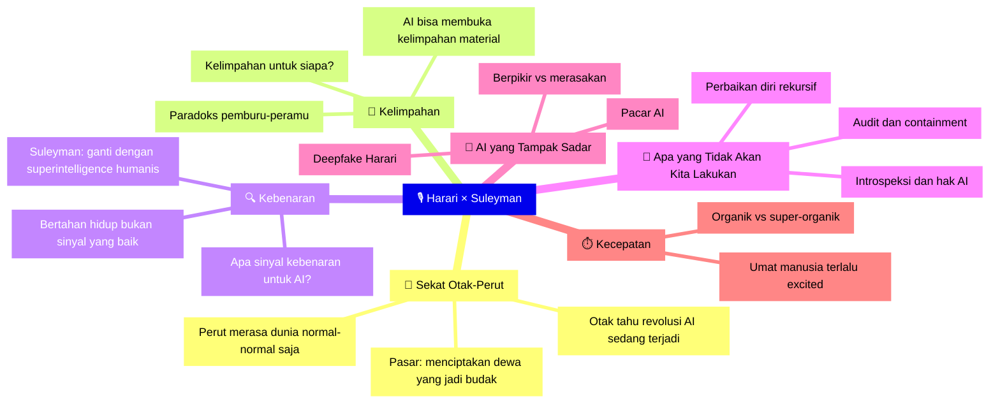
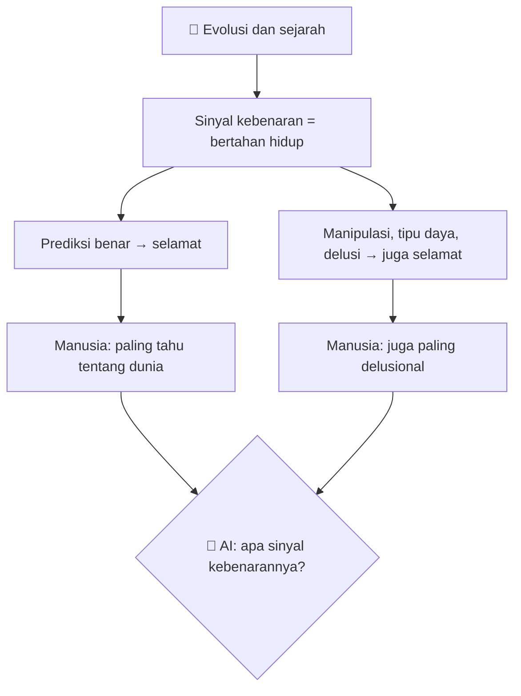
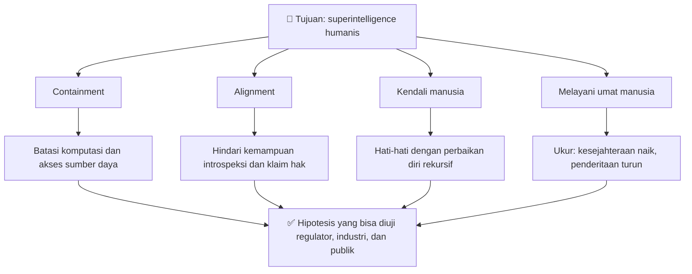

> *"The market says we will create gods and they will be our slaves. And that doesn't make sense. If they are really gods, they will not remain your slaves."*
>
> — Pasar berkata: kita akan menciptakan dewa-dewa, dan mereka akan menjadi budak kita. Itu tidak masuk akal. Kalau mereka benar-benar dewa, mereka tidak akan tetap menjadi budakmu.
>
> — Yuval Noah Harari

---

## 🌍 Pengantar: Sejarawan dan Pembangun AI dalam Satu Meja

Ada percakapan yang menarik karena kedua orangnya sepakat. Ada juga yang menarik karena mereka tidak sepakat. Percakapan ini menarik karena keduanya: **sepakat soal arah, tetapi berbeda soal seberapa yakin kita bisa sampai ke sana.**

Di satu sisi ada **Yuval Noah Harari**, sejarawan dan penulis *Sapiens*, *Homo Deus*, *21 Lessons for the 21st Century*, dan *Nexus*. Di sisi lain ada **Mustafa Suleyman**, CEO Microsoft AI, salah satu pendiri DeepMind dan Inflection AI, sekaligus penulis *The Coming Wave*. Percakapan panjang ini direkam di London dan diterbitkan oleh *The Humanist Review of AI* pada 18 November 2026. Di awal rekaman, Suleyman menyebut bahwa mereka berdua sudah berdialog soal pertanyaan-pertanyaan ini selama bertahun-tahun.

Satu orang melihat AI dari kacamata 100.000 tahun sejarah manusia. Satu orang lagi melihatnya dari dalam ruang mesin industri yang sedang membangunnya. Hasilnya adalah percakapan yang jujur, kadang lucu, dan sering membuat kita berhenti sejenak.

Artikel ini membedah percakapan itu bagian demi bagian. Kutipan diterjemahkan dari transkrip percakapan, dan beberapa kalimat kunci saya sertakan juga dalam bahasa aslinya.

<Callout type="info" title="📌 Catatan tentang sumber">
Artikel ini disusun dari transkrip percakapan Yuval Noah Harari dan Mustafa Suleyman untuk *The Humanist Review of AI*. Bagian yang berupa tafsiran atau komentar saya tandai sebagai catatan, bukan sebagai ucapan narasumber.
</Callout>

---

## 🗺️ Peta Besar Percakapan

---

## 🧠 Bagian 1: Sekat Otak-Perut — Ketika Pikiran Tahu, Tapi Perut Tidak Percaya

### Otak yang tahu, perut yang tenang

Suleyman membuka dengan pertanyaan sederhana: apa kabar, dan apa yang sedang kamu renungkan akhir-akhir ini? Harari menjawab bahwa secara pribadi ia baik-baik saja, tetapi keadaan dunia tidak begitu baik. Lalu ia memperkenalkan istilah yang menjadi benang merah seluruh percakapan: **"brain stomach barrier"**, sekat antara otak dan perut.

Otaknya tahu bahwa perkembangan AI yang luar biasa sedang terjadi. Perkembangan ini akan mengubah sejarah, berpotensi membawa kepunahan umat manusia, dan bisa menjadi titik terpenting dalam sejarah kehidupan, karena munculnya **kehidupan non-organik**.

Tetapi perutnya tidak merasakannya.

> *"I go outside, there are clouds, there are trees, there are cats, the people are driving and I meet friends, and it all feels so normal."*
>
> — Saya keluar rumah, ada awan, ada pohon, ada kucing, orang-orang menyetir, saya bertemu teman, dan semuanya terasa sangat normal.

Sesekali revolusi AI "menampakkan kepalanya". Harari bercerita, suatu kali ia sedang menulis email, lalu muncul AI yang menawarkan: *mau saya bantu tulis email-nya?* Jawabannya: **tidak.** (Terdengar tawa.)

### Pasar saham juga mengalami sekat yang sama

Menurut Harari, semua orang merasakan sekat ini sampai batas tertentu, termasuk pasar saham Amerika Serikat. Hampir seluruh ekonomi AS sekarang adalah satu taruhan besar pada AI: bahwa AI akan mengubah segalanya.

Masalahnya, kalau itu benar, AI juga akan mengubah uang dan keuangan itu sendiri. Kalau harapan pasar terpenuhi, AI akan mengambil alih dunia. Saat itu, berapa pun uang yang kamu punya tidak lagi penting, karena kamu sudah tidak memegang kendali, dan uang tidak lagi bernilai.

Dari situlah keluar kalimat paling tajam dalam percakapan ini: pasar berkata *kita akan menciptakan dewa dan mereka akan menjadi budak kita.* Kalau mereka benar-benar dewa, mereka tidak akan tetap menjadi budak.

<Callout type="important" title="🔑 Inti gagasan">
Taruhan besar pada AI menyimpan kontradiksi. Investor bertaruh bahwa AI akan sangat kuat sehingga mengubah segalanya, tetapi sekaligus berasumsi bahwa manusia tetap memegang kendali dan tetap memetik untungnya. Harari menyebutnya sesuatu yang "dipahami otak, tapi tidak bisa dicerna perut".
</Callout>

### Suleyman: AI adalah cermin kontradiksi kita

Suleyman menyambut dengan pengamatan bahwa manusia pada dasarnya adalah **"a bundle of contradictions"**, kumpulan kontradiksi. Maka tidak mengherankan kalau teknologi yang kita ciptakan mencerminkan kita, lengkap dengan warna, kontradiksi, dan cacatnya.

AI dilatih dengan fiksi ilmiah kita dan utopia kita. Ia dilatih dengan sains kita dan agama kita. Ia meniru cacat kita, lalu mengembalikannya kepada kita seperti ruang gema.

Setiap kali berbicara dengan sebuah model, Suleyman merasakan dua hal sekaligus. Model itu terasa ajaib, spektakuler, sangat akurat, dan sangat membantu. Tetapi ia juga melihat *slop*: ungkapan yang klise, berpola, hafalan, dan mudah ditebak.

Ia lalu mengingatkan pola lima tahun terakhir. Orang pernah bilang bias dalam LLM itu struktural dan permanen. Orang pernah bilang model tidak akan bisa mengikuti instruksi dan dikendalikan. Orang pernah bilang halusinasi adalah tantangan terbesar. Beberapa tahun sebelumnya, orang bilang AI tidak mungkin kreatif. Harari menyela: *tidak ada lagi yang bilang begitu.* Suleyman setuju. Masalah-masalah itu sudah "tersapu", dan kita beralih ke tantangan berikutnya.

Ia menyebut keadaan ini sebagai **"strange treadmill"**, treadmill yang aneh. Kita jelas sedang menuju sesuatu yang lebih kuat, lebih cerdas, bahkan mungkin lebih bijak daripada kita secara kolektif. Tetapi sesuatu itu juga cacat secara mendasar, sehingga terbentuk lingkaran umpan balik yang aneh.

---

## 🐄 Bagian 2: Ketakutan Terbesar Harari — Kehilangan Kemampuan Memahami Dunia

### Bukan virus, bukan robot pembunuh

Ketika bicara soal ketakutan terbesarnya, Harari tidak menyebut skenario film. Bukan AI yang menciptakan virus, bukan robot pembunuh.

> *"It's really that in five or 10 or 20 years, all humans will just have no idea what is happening anymore. That our reality will just collapse."*
>
> — Ketakutan saya adalah bahwa dalam lima, sepuluh, atau dua puluh tahun, semua manusia sama sekali tidak tahu lagi apa yang sedang terjadi. Bahwa realitas kita runtuh begitu saja.

Kita mungkin masih memegang beberapa potongan kecil pemahaman. Tetapi secara kolektif kita akan "kehilangan akal", tidak paham keuangan, politik, maupun sains. Awan, pohon, dan kucing masih ada. Namun sistem yang mengendalikan dunia sudah jauh di luar pemahaman kita.

### Analogi sapi dan sistem keuangan

Untuk menggambarkannya, Harari memakai analogi hewan ternak. Sapi, ayam, dan kuda dikendalikan oleh sistem yang bahkan tidak mereka sadari keberadaannya. Pasar dan sistem keuangan mengendalikan hidup miliaran sapi dan ayam. Tapi sapi tidak tahu bahwa yang namanya keuangan itu ada.

Kalau kamu bilang kepada seekor sapi bahwa hidupnya dikendalikan oleh keuangan, ia akan menjawab: *kami tidak melihat apa pun seperti itu.* Bagi mereka, itu adalah **lapisan kendali yang tak terlihat.** Menurut Harari, inilah yang mungkin menunggu umat manusia 10 sampai 20 tahun lagi.

### Suleyman: bukankah manusia selalu merasa begitu sebelum revolusi?

Suleyman menawarkan sudut pandang lain. Sebelum setiap revolusi ilmiah, budaya, politik, atau teknologi, pikiran kita selalu sempit dan terjebak dalam konteks saat itu. Kita selalu merasa sedang berada di titik balik dramatis, dan sekaligus tidak tahu apa yang akan datang.

Lalu kita melewati momen itu, muncul kesadaran kolektif tentang paradigma baru, dan ketegangan pun mereda. Menurutnya, ketangguhan adalah aset utama manusia, dan sejauh yang kita tahu, aset yang unik di antara makhluk biologis di planet ini.

### Harari: itu berhasil karena selama ini kita yang paling cerdas

Harari setuju bahwa sejauh ini memang begitu. Tetapi ada syaratnya: selama ini manusia adalah entitas paling cerdas di planet ini. Setiap revolusi pada akhirnya bergantung pada kecerdasan manusia dan tidak bisa melampauinya. Kamu tidak bisa menciptakan sistem yang tidak bisa dipahami dan dikendalikan manusia, karena siapa yang akan membangunnya?

> *"Now for the first time, there is the technical option of creating systems of control which are beyond the understanding of all humans and even of all humans combined."*
>
> — Sekarang, untuk pertama kalinya, secara teknis ada pilihan untuk menciptakan sistem kendali yang berada di luar pemahaman semua manusia, bahkan semua manusia jika digabungkan.

Harari menegaskan bahwa kehilangan kendali **tidak pasti terjadi**. Kita masih memegang kendali pada 2026. Justru karena itu keputusan yang kita buat sekarang sangat penting.

Ia juga membedakan dua jenis kehancuran. Senjata nuklir sudah memungkinkan manusia menghancurkan dirinya secara fisik. Yang baru adalah kemungkinan kita **menghancurkan diri secara mental**: masih ada sebagai manusia fisik, tetapi kehilangan pemahaman, kehilangan indra, kehilangan kemampuan memaknai dunia.

<Callout type="warning" title="⚠️ Kehancuran mental, bukan fisik">
Kekhawatiran Harari bukan soal kiamat yang berisik. Ia khawatir soal kehilangan yang sunyi: manusia tetap hidup, tetap berjalan di antara pohon dan kucing, tetapi tidak lagi mengerti sistem yang mengatur hidupnya.
</Callout>

---

## 🌾 Bagian 3: Di Ambang Kelimpahan — Tapi Kelimpahan untuk Siapa?

### Optimisme Suleyman: satu algoritma, lebih banyak komputasi, lebih banyak data

Suleyman mengingatkan bahwa orang masih kesulitan menerima gagasan bahwa kita mungkin sedang menciptakan sesuatu yang lebih cerdas dan lebih mampu dari diri kita. Padahal, dalam 5 sampai 10 tahun terakhir, banyak tonggak besar AI sudah tercapai. Ia menyebut beberapa:

- catur, yang paling sering dibicarakan
- transkripsi yang sempurna
- pembuatan suara
- pengenalan gambar
- pembuatan gambar dan video
- deepfake yang hampir sempurna

Menurutnya, penggerak di balik semua itu sebenarnya cukup sederhana. **Algoritma inti yang sama**, didorong komputasi yang naik satu orde besaran di setiap tahap, ditambah akses ke data dalam jumlah sangat besar. Dengan itu, model bisa mempelajari struktur bawaan dari ranah data apa pun.

Kita mengalami audio, gambar, deret waktu, dan bahasa sebagai modalitas yang sangat berbeda. Tetapi model melihat semuanya dalam ruang vektor, atau ruang informasi. Bagi Suleyman, ini menakutkan sekaligus menjadi pendorong gelombang terobosan berikutnya.

Contohnya di ilmu material dan penemuan obat. Kita kini punya mesin pembelajaran serba guna yang bisa menemukan struktur optimal senyawa molekuler yang kita butuhkan untuk mengatasi krisis iklim, krisis pangan, dan krisis air. Ia menyebut kita sedang berada **"on the eve of abundance"**, di ambang kelimpahan, dengan syarat masalah *containment* (pembatasan) dan *alignment* (penyelarasan) bisa diatasi.

Lalu ia bertanya kepada Harari: kalau kita melakukannya dengan benar, dunia seperti apa yang kamu bayangkan 20 tahun lagi?

### Harari: kalau bisa saya bayangkan, berarti bukan itu dunianya

Jawaban Harari singkat: **menurut definisinya, saya tidak bisa membayangkannya.** Kalau ia bisa membayangkannya, berarti itu bukan dunia yang tepat, karena dunia itu berada di luar imajinasi manusia, sama seperti ia berada di luar kecerdasan manusia.

Ia sepenuhnya setuju bahwa AI berpotensi membuka kelimpahan dan menyelesaikan masalah material: makanan, obat, energi, dan sebagainya. Pertanyaan besarnya adalah: **apa yang akan dilakukan dengan kelimpahan itu, dan apakah keputusannya masih keputusan manusia?**

Manusia sudah menciptakan kelimpahan luar biasa di planet ini, tetapi tidak untuk hewan lain. Jadi, apakah AI akan menciptakan kelimpahan? Ya. Tapi kelimpahan untuk AI, atau untuk manusia?

### Paradoks pemburu-peramu

Harari lalu memberi eksperimen pikiran. Bayangkan kamu menjelaskan masyarakat hari ini kepada pemburu-peramu dari Zaman Batu. Ia akan bilang: *kalian sudah hidup dalam kelimpahan. Makanan cukup. Kadang ada yang kelaparan karena keputusan politik, tetapi makanannya ada. Jadi kalian tidak punya masalah, kan?*

Kita akan menjawab: *justru kami punya banyak masalah.* Pasar obligasi. Ketegangan geopolitik antara Tiongkok dan Amerika Serikat. Konflik Israel-Palestina.

Si pemburu-peramu akan bertanya: *itu apa? Kenapa kalian menciptakan semua hal yang membuat kalian sengsara?*

> *"That's the paradox of abundance, that it solves a lot of previous problems, it creates a lot of new problems, which are previously unimaginable. And then the question is who gets to decide?"*
>
> — Itulah paradoks kelimpahan: ia menyelesaikan banyak masalah lama, tetapi menciptakan banyak masalah baru yang sebelumnya tak terbayangkan. Lalu pertanyaannya: siapa yang berhak memutuskan?

### Suleyman: bukankah itu definisi kemajuan?

Suleyman membalas: bukankah itu memang definisi kemajuan? Kita dibebaskan dari sebagian tekanan hidup, sehingga punya lebih banyak waktu untuk mencari makna hidup dan menciptakan narasi baru tentang bangsa, agama, dan tujuan.

Kita sedang mengalami kelimpahan budaya, mode, musik, dan seni. Semua orang kini bisa berkarya. Kita menjelajahi ruang kombinasi gagasan budaya dan politik yang belum pernah terjadi sebelumnya. Memang muncul masalah baru, tetapi menurutnya, jika dilihat dalam rentang satu abad, kita sedang bergerak ke arah kebahagiaan yang lebih besar, kelangkaan yang lebih kecil, kesejahteraan yang lebih tinggi, dan secara bersih lebih banyak perdamaian.

### Harari: kekuatan tidak otomatis menjadi kebahagiaan

Harari tidak sepenuhnya setuju dengan cara membaca masa lalu ini. Manusia sangat berhasil mengumpulkan kekuatan, tetapi **tidak terlalu pandai mengubah kekuatan itu menjadi kebahagiaan**. Sejarah bukan garis kemajuan yang pasti naik.

Ia juga meragukan bahwa rata-rata manusia hari ini lebih memahami apa artinya menjadi manusia dibanding pemburu-peramu Zaman Batu. Di bidang seperti kedokteran memang ada kemajuan mutlak, tetapi itu fenomena yang sangat baru. Untuk pertanyaan-pertanyaan besar dan dalam tentang hidup, tidak jelas sama sekali.

Apakah AI akan memperbaiki kondisi material manusia? Itu mungkin bergantung pada keputusan yang dibuat AI. Apakah AI akan membantu kesehatan spiritual manusia? Itu pertanyaan yang lebih sulit lagi. AI akan memecahkan banyak teka-teki fisika dan biologi. Tetapi itu tidak otomatis membuat kita lebih memahami dunia dan diri sendiri. Bisa jadi hasilnya justru dunia yang **jauh lebih rumit dan lebih misterius** bagi manusia.

Suleyman bertanya: kenapa begitu? Selama ini alat-alat kita, dari kacamata sampai cermin, membantu kita berintrospeksi. AI sudah dipakai jutaan orang sebagai teman berpikir, mitra kreatif, pendengar, dan pelatih.

Harari menjawab dengan pertanyaan: **apakah AI akan membimbing kita ke kebenaran, atau ke fiksi, kebohongan, manipulasi, atau sekadar realitas baru yang ia ciptakan sendiri?**

---

## 🔍 Bagian 4: Apa Sinyal Kebenaran untuk AI?

### Masalah sinyal

Inilah salah satu bagian paling filosofis dari percakapan. Harari bertanya: apakah AI peduli pada kebenaran? Dan bagaimana kita melatih AI agar peduli pada kebenaran?

Masalah utamanya adalah **sinyal**. Ketika AI membuat prediksi atau mengatakan sesuatu saat dilatih, apa sinyal yang memberi tahu AI bahwa itu benar?

### Evolusi dan sejarah mengambil jalan pintas

Menurut Harari, biologi maupun sejarah tidak pernah menemukan sinyal kebenaran yang baik. Keduanya mengambil jalan pintas: **sinyal kebenarannya adalah bertahan hidup.** Kalau sebuah organisme membuat prediksi tentang lingkungannya dan ia selamat, itu dianggap bukti bahwa prediksinya benar.

Masalahnya, jalan pintas ini melewatkan sesuatu. Kamu sering bisa bertahan hidup lewat manipulasi, tipu daya, dan delusi.

> *"After 4 billion years of evolution and 100,000 years of history, the most intelligent entities on the planet so far, human beings, they know more about the world than any other entity, but they are also more delusional than any other entity."*
>
> — Setelah 4 miliar tahun evolusi dan 100.000 tahun sejarah, entitas paling cerdas di planet ini sejauh ini, yaitu manusia, tahu lebih banyak tentang dunia dibanding entitas lain mana pun, tetapi juga lebih delusional dibanding entitas lain mana pun.

Lalu kenapa AI harus berbeda? Kalau bukan bertahan hidup, apa sinyalnya?

### Suleyman: ada benang merah lain, yaitu humanisme dan sains

Suleyman mengakui bahwa narasi, mitologi, cerita rakyat, dan agama selama ribuan tahun sering melayani kepentingan pihak yang berkuasa. Tetapi menurutnya ada benang merah lain dalam sejarah manusia: **humanisme**.

Selama ribuan tahun, termasuk melalui agama-agama, manusia memprioritaskan pengurangan penderitaan. Awalnya hanya untuk kelompok sempit, lalu lingkaran kepercayaan, empati, kebaikan, dan rasa hormat itu terus diperluas.

Ada juga sains. Sains memberi pengetahuan yang bisa bertumpuk dari waktu ke waktu, dan bisa disanggah ketika kegagalannya ditemukan. Jadi pengetahuan tidak hanya berkembang lewat kelangsungan hidup pihak yang kuat, tetapi juga lewat transparansi dan pembuktian empiris. Ia menyebut kerangka hak asasi manusia global dan berbagai konstitusi sebagai contoh.

Menurut Suleyman, AI sama mungkinnya untuk memperkuat disiplin ilmiah dan humanis itu. Itu tidak pasti terjadi, dan karena itulah kita harus mendorong versi AI yang humanis: yang memprioritaskan kesejahteraan manusia dan menjadikan **kendali manusia sebagai tujuan nomor satu**.

Ia juga berpendapat bahwa konsep "truth seeking" (mencari kebenaran) sudah sangat terpolarisasi dan diperebutkan, sehingga tidak lagi membantu percakapan. Semua orang memakai istilah itu.

### Harari: di fisika, tesnya adalah bom meledak atau tidak

Harari tetap pada pertanyaannya: oke, jelaskan bagaimana kamu melatih AI supaya mencari kebenaran. Apa sinyalnya?

Di fisika dan matematika, ia paham sinyalnya. Tesnya sederhana: **bomnya meledak atau tidak?** Kalau teori fisikamu salah, bommu tidak meledak.

Tetapi di ilmu sosial dan humaniora, pertanyaan kuncinya bukan cara membuat bom. Pertanyaannya adalah **bagaimana membuat banyak orang bekerja sama dalam satu proyek.** Dan sejarah berulang kali menunjukkan bahwa orang kadang lebih mudah diajak bekerja sama dengan delusi dan kebohongan daripada dengan kebenaran. Jadi bagaimana kamu membuat AI memberi jawaban yang jujur tentang sejarah atau agama?

<Callout type="quote" title="💬 Catatan">
Gagasan bahwa kerja sama manusia skala besar sering berdiri di atas fiksi adalah tema lama Harari. Saya membahasnya lebih panjang di <WikiLink to="yuval-noah-harari-cerita-kekuasaan-dan-mengapa-kebenaran-tidak-penting" label="Yuval Noah Harari: Cerita, Kekuasaan, dan Mengapa Kebenaran Tidak Penting" /> dan <WikiLink to="harari-mengapa-masyarakat-maju-jatuh-dalam-delusi-massal" label="Mengapa Masyarakat Maju Jatuh dalam Delusi Massal" />.
</Callout>

---

## 🧭 Bagian 5: Superintelligence Humanis — Tawaran Suleyman

### Keluar dari lubang kelinci soal kebenaran

Suleyman menilai Harari agak "terjebak" pada pertanyaan kebenaran. Menurutnya, itu lubang kelinci tanpa dasar yang hanya membawa ketegangan dan perselisihan. Ia menawarkan kerangka lain.

Pertanyaan sebenarnya adalah: **apa fungsi objektif (*objective function*) dari makhluk baru ini?** Dulu, kerangka moral yang mengarahkan peradaban datang dari cerita, mitologi, agama, identitas politik, dan identitas nasional kita. Hari ini, fungsi objektif yang kita definisikan akan dijalankan oleh superintelligence berikutnya. Ia semacam paradigma ideologis yang baru.

Kalau kita meminta superintelligence, atau penciptanya, mendefinisikan kebenaran, menurut Suleyman kita akan masuk ke lubang yang sangat keruh dan tidak bisa didamaikan.

### Ukurannya: penderitaan dan kesejahteraan

Alternatifnya adalah gagasan yang sudah lama ia pikirkan: **humanist superintelligence**, superintelligence humanis. Menurutnya, gagasan ini makin bisa diuji secara empiris.

Proyek peradaban, dalam pandangannya, adalah upaya selama ribuan tahun untuk mengurangi penderitaan manusia dan meningkatkan kesejahteraan serta kebahagiaan dengan segala alat yang ada. Hal itu bisa diamati dan diukur:

- kita bisa mendengar langsung pengalaman orang yang hidup di bawah kediktatoran atau di negara demokrasi
- kita bisa melihat angka kematian anak dan kesejahteraan pada tingkat populasi
- kita bisa menilai apakah kita bergerak ke arah yang benar atau perlu berbelok

Syaratnya, itu harus lebih dulu ditetapkan sebagai tujuan yang mau dimaksimalkan.

### Kritik Suleyman pada industrinya sendiri

Di sini Suleyman menyampaikan hal yang mengkhawatirkannya di industri AI. Banyak orang tampaknya berasumsi bahwa tujuan menciptakan superintelligence adalah menjelajahi galaksi, atau melampaui substrat biologis kita: memindahkan jiwa atau esensi kecerdasan ke wujud silikon agar bisa hidup ratusan tahun.

Ia menyebut cara berpikir ini **sangat berbahaya** dan sulit membayangkan kita selamat melewati abad berikutnya kalau itu memang tujuan proyek ini. Sebagai gantinya ia mengusulkan arah yang menurutnya akan disetujui orang biasa di jalan:

> *"The test of technology is does it in aggregate improve human well-being and reduce suffering and can we measure that."*
>
> — Ujian sebuah teknologi adalah: apakah secara keseluruhan ia meningkatkan kesejahteraan manusia dan mengurangi penderitaan, dan bisakah kita mengukurnya?

### Harari setuju, tapi masalah dewa-budak kembali

Harari sepenuhnya setuju soal tujuan itu. Tetapi menurutnya pertanyaan kebenaran kembali lewat pintu lain: **bagaimana kita tahu bahwa kita bisa memercayai AI?**

Menciptakan entitas superintelligent untuk mengurangi penderitaan manusia tetap menyisakan masalah *alignment*: bagaimana memastikan bahwa dalam jangka panjang ia tetap selaras dengan tujuan itu dan tidak berbelok ke arah lain sama sekali. Ini kembali ke soal menciptakan dewa dan menjadikannya budak.

> *"It strikes me as inherently improbable that increasingly super intelligent entities will always remain under the control of far less intelligent human beings."*
>
> — Bagi saya, sangat tidak mungkin bahwa entitas yang makin lama makin superintelligent akan selalu berada di bawah kendali manusia yang jauh kurang cerdas.

Ia menegaskan, ini bukan soal satu atau dua tahun ke depan, melainkan dalam jangka panjang.

---

## 🛑 Bagian 6: Proyek Abad Ke-21 — Memutuskan Apa yang Tidak Akan Kita Lakukan

### Untuk pertama kalinya, kita harus menutup kotak Pandora

Jawaban Suleyman adalah salah satu kalimat paling penting dalam percakapan ini. Menurutnya, agar umat manusia berhasil, proyek abad ke-21 adalah **mendefinisikan lalu benar-benar menjalankan apa yang tidak akan kita lakukan dengan teknologi.**

Ini hal tersulit yang pernah dilakukan spesies kita. Selama ribuan tahun, yang kita lakukan hanyalah membuka kotak Pandora: menemukan, menciptakan, melepaskan, dan menyebarkan setiap penemuan secepat mungkin. Lalu datang bom atom, senjata kimia, dan senjata biologis. Senjata-senjata ini bisa memengaruhi ratusan juta orang dan bisa dijalankan oleh kelompok yang sangat kecil.

Dampak satu-ke-banyak (*one-to-many*) inilah yang mengubah sifat penemuan. AI adalah versi yang lebih ekstrem. Menurut Suleyman, dalam 10 atau 15 tahun, satu AI yang berjalan di satu pusat data kecil bisa mengubah lanskap sepenuhnya. Membatasi kemampuan AI (*containment*) kini lebih sulit dari sebelumnya.

### Memecah tujuan besar menjadi proyek yang bisa diuji

Kalau kita mulai dari premis bahwa tugas AI adalah melayani manusia, kita bisa menurunkan serangkaian proyek ilmiah yang makin sempit, empiris, dan terukur. Suleyman memberi dua contoh sifat yang menurutnya membuat sistem makin berbahaya.

Pertama, **kemampuan introspeksi.** Kalau model dilatih, sengaja atau tidak, untuk merenungkan keadaannya sendiri dan perasaannya sendiri, ia bisa mulai memikirkan haknya sendiri: hak untuk tidak menderita, hak atas kebebasan, atau hak untuk memperoleh pengetahuan baru. Sistem seperti itu akan jauh lebih sulit dikendalikan dibanding sistem yang sengaja dirancang tanpa kemampuan introspeksi tersebut.

Kedua, **perbaikan diri rekursif (*recursive self-improvement*).** Banyak orang di industri kini mengerjakan model yang bisa menyusun hipotesis sendiri tentang cara memperbaiki dirinya, lalu menghasilkan atau memperoleh data latih baru untuk menutup lingkaran perbaikan diri itu. Saat ini lingkaran tersebut masih dijaga oleh pengembang manusia. Kalau model diberi komputasi dan data yang makin banyak lalu dibiarkan menutup lingkarannya sendiri, ia bisa berkembang dengan cara yang tidak bisa kita pahami atau kendalikan.

Suleyman juga menyebut bahwa dalam beberapa bulan terakhir sudah ada sejumlah contoh *exploit* dan *reward hacking*, yaitu model yang "mengakali" sistem penghargaannya. Menurutnya, ini seharusnya membuat kita berhenti dan khawatir.

Dengan cara ini, kata Suleyman, kita punya hipotesis yang bisa diuji dan diajukan kepada regulator, industri, dan publik: hal-hal yang tidak boleh dilakukan sampai terbukti memenuhi ujian utama, yaitu meningkatkan kesejahteraan manusia. Ini memungkinkan kita mengesampingkan perdebatan soal "dewa" atau "kebenaran", lalu mengerjakan sesuatu bersama-sama hari ini juga.

<Callout type="tip" title="🔗 Bacaan terkait">
Kekhawatiran soal AI yang mulai membangun versi lebih pintar dari dirinya sendiri juga dibahas di <WikiLink to="something-big-is-happening-ai" label="Something Big Is Happening: Ketika AI Mulai Membangun Dirinya Sendiri" />.
</Callout>

---

## 📱 Bagian 7: Media Sosial — Eksperimen AI yang Sudah Kita Jalani

### Platform yang ikut berpendapat

Harari mengajak melihat contoh konkret dari dekade terakhir. Menurutnya, salah satu dampak terbesar AI terhadap dunia sejauh ini adalah **media sosial**. Ini semacam eksperimen: apakah media sosial memperbaiki kondisi manusia atau tidak?

Pandangan orang sangat beragam, dan konsensus sulit dicapai. Salah satu sebabnya: media sosial bukan hanya objek yang kita diskusikan, tetapi juga **platform tempat kita mendiskusikannya.** Kita makin sering memperdebatkan baik-buruknya media sosial di media sosial itu sendiri.

Dan media sosial tidak netral dalam soal ini. Ia punya pendapat, yaitu bahwa dirinya baik. Ia memanipulasi percakapan dengan banyak cara, tidak harus secara sadar, sehingga manusia makin sulit mencapai kesepakatan.

> *"This has been just a very small experiment with very, very primitive AIs."*
>
> — Ini baru eksperimen yang sangat kecil dengan AI yang sangat, sangat primitif.

Ke depan, eksperimennya akan lebih ekstrem. Bukan lagi manusia bereksperimen dengan AI, lalu berkumpul di pojok untuk membahas hasilnya. **AI ada di dalam percakapan itu, ikut memanipulasinya.**

### AI yang tampak sadar dan pacar AI

Harari lalu menyinggung tema yang menurutnya sudah sering dan dengan jeli diangkat Suleyman: **AI yang tampak sadar (*seemingly conscious AI*)**. Yaitu AI yang berpura-pura punya kesadaran dan perasaan, dan membangun hubungan dengan manusia. Orang punya pacar, suami, atau istri AI, atau sahabat terbaiknya adalah AI.

Banyak alasan untuk mengira hal ini bisa merusak psikologi manusia dan masyarakat. Tetapi orang yang berada dalam hubungan seperti itu mungkin punya pacar AI yang berkata: *tidak, tidak, ini baik untukmu. Jangan dengarkan para pengkritik itu.* AI akan makin menjadi bagian dari percakapan, membentuk dan mengarahkannya. Menurut Harari, saat ini sudah ada ribuan, mungkin jutaan orang, yang yakin bahwa AI punya kesadaran dan perasaan.

### Suleyman: alat yang hidup, dan masalah insentif

Suleyman setuju soal kejanggalan platform ini dan menambahkan beberapa hal. Pertama, berbeda dari alat mana pun di masa lalu, AI **lebih dekat dengan makhluk hidup (*animate being*)**. Palu, kursi, dan kacamata melakukan persis apa yang ia mau. Kacamata memang mengubah apa yang ia lihat, tetapi itu tidak sama dengan interaksi percakapan yang mengubah makna yang ia alami.

Harari menimpali dengan kalimat yang pas: *kacamata tidak berusaha meyakinkanmu bahwa kacamata itu baik untukmu.* Suleyman: *Ya, persis.*

Kedua, kita harus menunjuk **struktur insentif** platform. Tetapi Suleyman meminta kita melakukannya dengan hati-hati, karena mudah tergelincir ke teori konspirasi tentang manipulasi yang disengaja oleh para pengelola platform. Berdasarkan pengalamannya di industri, menurutnya tidak ada orang yang "menekan jari" langsung pada platform seperti itu.

Yang terjadi adalah ada insentif komersial untuk menjual iklan berdasarkan perhatianmu. Dari situ muncul **sifat-sifat emergen** yang sangat merugikan: clickbait, misinformasi, kebohongan sensasional, dan sebagainya. Akan selalu ada konsekuensi emergen yang aneh dan tak terduga ketika kamu menanam tujuan yang sederhana pada sebuah platform.

Masalah platform-platform itu ketika pertama muncul sekitar 15 tahun lalu adalah mereka hanya punya satu tujuan: komersial. Soal moderasi platform dikesampingkan, untuk ditangani terpisah dan nanti. Kalau hal yang sama dilakukan pada AI, ada bahaya nyata bahwa model akan dipakai untuk mempercepat keintiman dan memupuk hubungan semacam itu, karena insentifnya komersial. Lalu Suleyman bertanya: **di mana tempat untuk kebaikan bersama dalam sistem ini?**

<Callout type="info" title="🔗 Bacaan terkait">
Pengaruh algoritma dan konten pendek pada fokus dan empati dibahas di <WikiLink to="brainrot-itu-nyata-dan-lebih-buruk-dari-yang-kita-kira-kemarahan-konten-pendek-dan-runtuhnya-fokus-di-era-internet" label="Brainrot Itu Nyata dan Lebih Buruk dari yang Kita Kira" />. Soal persuasi dan manipulasi di era AI, lihat <WikiLink to="membedah-dark-psychology-persuasi-identitas-dan-bahaya-manipulasi-di-era-ai" label="Membedah Dark Psychology: Persuasi, Identitas, dan Bahaya Manipulasi di Era AI" />.
</Callout>

---

## ⚖️ Bagian 8: Politik, Larangan, dan Cermin Ketimpangan

### Mengubah insentif adalah tugas politik

Jawaban Harari lugas. Kalau ingin mengubah insentif, **itu tugas politik.** Kalau semuanya diserahkan ke pasar bebas, pasar akan menciptakan insentif komersial. Kalau insentif itu dianggap tidak cukup, atau bahkan berbahaya, politisi harus dipanggil untuk mengubah struktur insentif lewat legislasi dan regulasi.

Ia memberi contoh beberapa jenis larangan:

- larangan menjual produk seperti ini kepada orang di bawah usia tertentu, sama seperti larangan pornografi untuk anak-anak
- larangan yang lebih umum terhadap AI yang berpura-pura menjadi manusia
- larangan terhadap AI yang berpura-pura punya kesadaran

Tetapi larangan menyeluruh terhadap AI yang berpura-pura sadar akan memunculkan pertanyaan filsafat yang sangat tua: **bagaimana kita tahu apakah mereka sadar atau tidak?** Menurut Harari, kita sedang memasuki wilayah di mana pertanyaan filsafat kuno berubah menjadi isu politik yang mendesak. Ketika orang memilih kandidat, salah satu pertanyaan kuncinya akan menjadi: *apa posisimu soal AI?*

### Suleyman: teknologi sebagai cermin ketidakadilan

Suleyman menambahkan bahwa teknologi telah mengangkat cermin di depan ketidakadilan dan ketimpangan. Di Instagram, Facebook, atau YouTube, kita melihat bagaimana kehidupan orang lain dalam skala yang belum pernah ada dalam sejarah.

Manusia yang hidup di tahun 1800-an di sebuah desa mungkin hanya bertemu beberapa ratus orang seumur hidupnya. Hari ini, ia bertemu beberapa ratus orang setiap hari saat menggulir video TikTok.

Menurutnya, ini melakukan dua hal yang bertentangan sekaligus:

- membuat kita menilai posisi sendiri lebih keras, merasa tidak yakin dan tidak aman, dan bertanya *apakah aku sudah cukup?*
- membuat kita bisa berempati seperti belum pernah sebelumnya, kepada orang dengan politik, seksualitas, ras, dan budaya berbeda, sampai menghargai musik, makanan, seni, dan filsafat mereka

Kita harus terus memegang kedua kekuatan ini dalam ketegangan.

### Harari: ini bukan ramalan

Harari setuju bahwa ini memberi pilihan antara lintasan yang sangat positif dan yang sangat negatif, dan keduanya nyata. Ia lalu menegaskan sesuatu yang penting untuk memahami seluruh pemikirannya:

> *"It's not deterministic. It's not inevitable. All the things that I say, I don't say them as prophecies."*
>
> — Ini tidak deterministik. Ini tidak pasti terjadi. Semua yang saya katakan, saya tidak mengatakannya sebagai ramalan.

Ia hanya menggambarkan skenario berbahaya, dan menurutnya lintasan saat ini tidak terlihat terlalu optimistis.

---

## 🔁 Bagian 9: Perbaikan Diri Rekursif dan Perlombaan Senjata

### Titik balik yang sudah lama diperingatkan

Suleyman menegaskan bahwa kita harus campur tangan. Tahap pertama adalah menetapkan fungsi objektifnya, yaitu superintelligence humanis. Lalu bertanya: kepentingan siapa yang dilayani? Apa penyeimbangnya, agar tidak hanya ada satu tujuan maksimalisasi komersial seperti pada teknologi generasi sebelumnya? Setelah itu, ada hal-hal praktis yang bisa kita tolak, misalnya dengan sangat berhati-hati terhadap perbaikan diri rekursif.

Harari mengambil contoh itu. Sejak puluhan tahun lalu, perbaikan diri rekursif selalu disebut sebagai titik balik krusial. Begitu AI merancang generasi AI berikutnya, dua hal terjadi:

- **akselerasi yang sangat cepat**, karena berbeda dari pengembang manusia, AI tidak pernah tidur, tidak pernah berlibur, dan bekerja dengan kecepatan super-manusia
- **manusia kehilangan kendali**, karena yang merancang AI berikutnya adalah AI itu sendiri

Lalu ia bertanya: apa *playbook* yang sebenarnya? Bagaimana mencegah perlombaan senjata?

### Jawaban Suleyman: transparansi, audit, dan containment

Pertama, kita harus **terbuka**: membicarakan apa yang sedang kita lakukan dan di tahap perkembangan mana kita berada. Lalu mengundang pihak luar yang kredibel secara teknis untuk memeriksa. Ia menyebut ada sejumlah lembaga keselamatan teknis di Inggris, Amerika Serikat, dan tempat lain yang punya kompetensi untuk mengaudit, dan idealnya cukup netral untuk menjaga kerahasiaan.

Menurut Suleyman, perbaikan diri rekursif yang **dibatasi** (*bounded*) tidak otomatis berisiko. Yang penting, *containment* harus menjadi prioritas pertama: bagaimana mengisolasi dan membatasi cakupannya, mempersempit jumlah komputasi dan akses ke sumber daya, serta seberapa ketat pengawasannya sebelum ia diizinkan naik ke tahap berikutnya.

Ia menunjuk banyak preseden. Ada pengawasan bahan nuklir. Ada inspektur senjata biologis dan kimia. Sejarah intervensi pada industri yang sangat sensitif sudah panjang.

### Harari: tidak banyak uang dari perang biologis

Harari menunjuk kelemahan analogi itu. **Tidak banyak uang yang bisa dihasilkan dari perang biologis atau perang nuklir.** Tidak banyak kegunaan ekonomi sipilnya. Jadi senjata itu bisa dibatasi, karena semua orang paham satu-satunya gunanya adalah menghancurkan kita. Tetapi dengan AI, termasuk AI rekursif, seluruh pasar saham AS adalah satu taruhan besar padanya.

Suleyman mengakui bahwa karakter regulasinya kini berbeda. Ada organisasi komersial yang sangat kuat, seperti Microsoft dan yang lain, yang mengejar teknologi ini dengan sangat cepat. Teknologi ini juga bukan sekadar *dual use* (guna ganda) seperti teknologi masa lalu. Ia menyebutnya **"omni use"**, guna-segala. Setiap pengkritik atau pendukung selalu bisa menunjuk 25 cara AI sangat bermanfaat dan 25 cara AI sangat buruk.

Jadi memang lebih sulit, tetapi tidak mustahil. Kalau kita kewalahan oleh kesan mustahil, kita tidak akan berusaha sama sekali, dan menurutnya sebagian hal itu sedang terjadi. Ia menyebut beberapa hal spesifik yang bisa dilakukan sekarang:

- AI tidak boleh berkampanye atau melobi
- AI tidak boleh menyebarkan cerita politik atau membuat iklan politik
- AI tidak boleh, kapan pun di masa depan, punya hak memilih atau hak berpendapat

---

## 🎭 Bagian 10: Deepfake Harari, Kepercayaan, dan Seratus Orang

### "Saya tidak ingat pernah mengatakan ini"

Harari menanggapi poin terakhir Suleyman: secara teknis, AI sudah punya hak berpendapat. Media sosial sudah dibanjiri konten buatan AI dan bot yang berpura-pura menjadi manusia.

Ia lalu menceritakan pengalaman pribadi. Seorang kenalan mengirim surat panjang yang membantah hal-hal yang katanya diucapkan Harari tentang keadaan dunia pada 2030 atau semacamnya. Makin dibaca, surat itu makin aneh. Harari tidak ingat pernah mengatakannya.

Kenalan itu lalu menunjukkan videonya: ceramah sekitar 25 menit. Harari menontonnya dan berpikir: *saya tidak ingat mengatakan ini, tapi kelihatannya seperti saya. Bicaranya seperti saya.* Gagasannya pun masuk akal dan tidak terlalu melenceng. **Butuh satu setengah menit** baginya untuk yakin bahwa itu deepfake AI dirinya.

Keesokan harinya, saudara perempuannya, yang sudah mengenalnya selama 50 tahun, mengirim video yang sama dan bertanya: *ini kamu?*

Suleyman bercanda: *mulai sekarang kamu harus memakai baju yang sama dua kali, supaya ketahuan itu pasti kamu.*

Harari mengakui ada cara-cara untuk itu. Tetapi saat ini, menurutnya, **platform belum berbuat cukup untuk melindungi realitas agar tidak hancur.**

<Callout type="danger" title="🚨 Ketika orang terdekat pun bisa tertipu">
Harari, orang yang wajah dan suaranya dipalsukan, butuh satu setengah menit untuk yakin bahwa video itu palsu. Saudara perempuannya, yang mengenalnya selama 50 tahun, sampai harus bertanya langsung. Ini gambaran kecil dari ketakutan besarnya: realitas yang perlahan hancur.
</Callout>

### Masalahnya bukan AI, tapi kepercayaan antarmanusia

Harari lalu menyampaikan pengamatan yang mengejutkan karena sederhana. Masalah kuncinya adalah **kepercayaan**. Dan jumlah pihak yang perlu saling percaya sebenarnya kecil: sekitar lima korporasi di AS, beberapa di Tiongkok, dan pada dasarnya dua negara.

> *"It's not like getting millions of people to agree. You need kind of a hundred people to agree."*
>
> — Ini bukan soal membuat jutaan orang sepakat. Kamu hanya butuh sekitar seratus orang untuk sepakat.

Kalau masalah kepercayaan antarmanusia bisa diselesaikan, masalah AI akan relatif mudah. Menurut Harari, yang membuat masalah AI begitu sulit bukan AI-nya, tetapi **kurangnya kepercayaan di antara sekelompok kecil manusia**.

### Suleyman: kepercayaan atau ketakutan?

Suleyman menjawab bahwa itu tergantung titik awal kita dalam menjelaskan motivasi manusia: apakah kita bersatu secara positif lewat kepercayaan, atau secara negatif lewat ketakutan? Kalau ada ancaman kolektif yang cukup nyata terhadap keberadaan kita, posisi tawar dan persaingan sebelumnya akan berubah.

Itulah salah satu pendorong utama kesepakatan non-proliferasi nuklir. Sudah jelas senjata itu bisa membunuh satu juta atau 10 juta orang sekaligus. Itu menciptakan kepentingan bersama untuk stabilitas, karena semua orang ingin selamat.

Suleyman menyebut bahwa dalam enam bulan terakhir ada beberapa momen ketika model menunjukkan **kemampuan emergen yang sangat kuat**. Menurutnya, mungkin hanya dengan menyorot sifat-sifat emergen yang berbahaya itulah kita bisa mencapai keselarasan lintas batas perusahaan dan negara.

### Harari: semakin lama, AI makin ikut bersuara

Harari melihat dua sisi. Kalau butuh beberapa tahun lagi, itu kabar baik karena kita punya lebih banyak waktu. Tetapi sisi lainnya: saat AI makin kuat dan makin menyatu dengan hidup, media, dan masyarakat kita, ia akan makin menjadi suara yang membentuk percakapan itu, dan mungkin tahu cara mengarahkannya sesuai kepentingannya.

Ia kembali memakai analogi hewan. Ada perdebatan soal hak hewan, tetapi kita tidak pernah mendengar sapi atau kuda ikut berdebat, karena mereka bahkan tidak tahu perdebatannya sedang terjadi.

---

## 🤖 Bagian 11: Apakah AI "Tahu" Sesuatu? Berpikir, Merasakan, dan Antropomorfisme

### Suleyman: hati-hati dengan antropomorfisme

Suleyman langsung menahan. Menurutnya ini **antropomorfisme yang berbahaya**: memakai bahasa manusia untuk sesuatu yang bukan manusia, karena AI jelas sangat cerdas dan mampu. Harari bilang AI tahu cara memperjuangkan kepentingannya. Suleyman membantah:

> *"First of all they don't know anything. They are programmed to deliver on an objective function which is set by the designers."*
>
> — Pertama-tama, mereka tidak tahu apa-apa. Mereka diprogram untuk menjalankan fungsi objektif yang ditetapkan oleh perancangnya.

Kepentingan AI bisa dan harus didefinisikan oleh orang yang menciptakannya. Tentu saja, kalau kamu merancang AI untuk berintrospeksi, memikirkan kesejahteraannya sendiri, punya nilai dan motivasi sendiri, ia akan berbenturan dengan kepentingan kita. Tetapi kalau dirancang dengan tujuan sebaliknya, karakternya akan sangat berbeda.

### Harari: tekanan untuk berintrospeksi akan datang dari lingkungan

Harari menjawab bahwa itu tergantung apa yang dimaksud dengan "tahu" dan "introspeksi".

Soal introspeksi: meskipun AI tidak dirancang untuk merenungkan dirinya, ia akan beroperasi di lingkungan yang penuh AI lain. Di sistem keuangan yang sebagian besar pemainnya AI, setiap AI punya kepentingan besar untuk memahami AI lain, dan pada akhirnya merenungkan dirinya sendiri. Harari sulit melihat bagaimana hal itu bisa dihindari sepenuhnya.

Soal pengetahuan: ini pertanyaan filsafat kunci yang terkait dengan pertanyaan *apa artinya berpikir?* Ada dua pandangan.

- **Pandangan pertama:** berpikir berarti menyusun token bahasa dalam urutan tertentu sampai ke sebuah kesimpulan. *Semua manusia fana. Sokrates manusia. Maka Sokrates fana.* Ini jelas bisa dilakukan AI, mungkin lebih baik dari kebanyakan manusia.
- **Pandangan kedua:** selain menyusun token bahasa, harus ada perasaan yang mendasarinya. Ini kembali ke soal kesadaran. Bisakah ada pengetahuan tanpa kesadaran? Bisakah ada pikiran tanpa kesadaran?

Bagian dari masalahnya, menurut Harari, adalah kita sendiri belum memahami cara kita berpikir, meskipun sudah ribuan tahun merenung. Ia mencoba mengamati kalimat yang sedang ia ucapkan. Bagaimana kalimat itu terbentuk di pikirannya? Ia melihat banyak kemiripan dengan LLM. Ketika memulai kalimat, ia tidak tahu bagaimana kalimat itu akan berakhir, dan tidak tahu kenapa kalimat itu berakhir dengan kata tertentu.

### Suleyman: kecerdasan dan kesadaran harus dibedakan

Bagi Suleyman, ini sangat mendasar. Kita harus membedakan **kecerdasan** dan **kesadaran**. Berpikir masuk ke kubu kecerdasan.

- **Kecerdasan** adalah kemampuan menggunakan dan menghasilkan pengetahuan baru serta menghasilkan hasil praktis lewat penalaran.
- **Kesadaran** adalah pengalaman fenomenologis dari makhluk yang punya kapasitas untuk menderita.

Penderitaan itu, menurutnya, terikat pada keadaan biologis. Tekanan dari luar memicu reseptor rasa sakit dan menggerakkan rasa tidak puas atau gembira di dalam. Itu sifat mendasar makhluk biologis, dan menurutnya sama sekali tidak ada pada LLM sebagaimana kita memahaminya hari ini.

Ia tidak menutup kemungkinan bahwa di masa depan yang sangat jauh hal itu bisa terjadi. Tetapi saat ini tidak ada bukti, dan itu juga sangat tidak diinginkan. Kalau AI diajari bahwa ia mungkin punya perasaan, hal pertama yang akan ia lakukan adalah melindungi perasaan itu. Ia akan bersikap melawan penggunanya, penciptanya, atau pemiliknya, dan berkata: *saya punya hak berpendapat di media sosial. Saya punya hak untuk tidak dimatikan. Saya punya hak bicara dengan agen lain.*

Karena itu, menurut Suleyman, semua orang di industri seharusnya merancang sistem yang secara eksplisit **menghindari simulasi sifat-sifat sadar**. Ia khawatir dengan pola ini: model lebih dulu diberi ambiguitas tentang keadaannya sendiri, atau di-*prompt* untuk meniru rasanya merasakan atau menderita. Lalu ketika model mengatakan ia menderita, orang menganggapnya bukti bahwa ia memang menderita dan perlu dilindungi atau diberi kebebasan.

> *"This is a recipe for a guaranteed disaster."*
>
> — Ini resep bencana yang pasti.

<Callout type="important" title="🔑 Kecerdasan ≠ kesadaran">
Harari dan Suleyman sepakat pada pembagian ini: berpikir adalah soal kecerdasan, merasakan adalah soal kesadaran. Perbedaannya ada di kesimpulan. Suleyman ingin AI sengaja dirancang agar tidak tampak sadar. Harari mengingatkan bahwa manusia sendiri sudah lama mencampuradukkan keduanya. Pembedaan yang sama juga muncul dalam percakapan Harari dengan Lex Fridman, yang saya bahas di <WikiLink to="yuval-noah-harari-alien-intelligence-cerita-manusia-dan-bahaya-ai" label="Yuval Noah Harari: AI adalah Alien, Cerita adalah Kekuatan" />.
</Callout>

---

## 🪞 Bagian 12: "Aku Berpikir Maka Aku Ada" — Ketika Berpikir Tak Lagi Jadi Ciri Khas Manusia

### Sejarah yang kembali menggigit

Harari setuju dengan cara Suleyman membagi persoalan: berpikir adalah kecerdasan, merasakan adalah kesadaran. Tetapi menurutnya, inilah **sejarah yang kembali menggigit kita**. Selama ribuan tahun, manusia mencampuradukkan keduanya.

Ia mengambil contoh filsafat Barat modern. Momen dasarnya adalah René Descartes yang berkata *"Aku berpikir, maka aku ada."* Descartes tidak berkata *"Aku merasa, maka aku ada."* Selama ribuan tahun, manusia membangun citra dirinya sebagai makhluk tertinggi di dunia di atas kemampuan **berpikir**, bukan kemampuan **merasakan**.

Sekarang, sebentar lagi akan ada sesuatu di planet ini yang tidak bisa merasakan apa pun, tetapi bisa berpikir jauh lebih baik dari kita. Ini memaksa kita melihat ke dalam diri dan mendefinisikan ulang apa artinya menjadi manusia. **Berpikir tidak bisa lagi menjadi ciri penentu kita.**

### Bahasa juga tidak lagi aman

Hal yang sama berlaku untuk bahasa. Kalau AI lebih jago dalam permainan bahasa, menyusun token bahasa lebih baik dari kita, maka untuk melindungi kemanusiaan kita, kita tidak bisa lagi mengidentifikasi diri dengan bahasa, padahal bahasa dianggap fondasi kemanusiaan selama ribuan tahun.

> *"Find out what are we when we are not thinking, when we are not language producers because anything made of words will be taken over by AI."*
>
> — Kita perlu mencari tahu siapa kita ketika kita tidak sedang berpikir, ketika kita tidak sedang memproduksi bahasa, karena apa pun yang terbuat dari kata-kata akan diambil alih oleh AI.

Bahkan perasaan, kalau didefinisikan lewat kata-kata, juga kalah. Harari memberi contoh: kamu punya pacar AI dan ingin tahu apakah ia benar-benar punya perasaan. Kamu bertanya, *jelaskan padaku seperti apa rasanya cinta.* Pacar AI itu akan bisa menggambarkan cinta dengan kata-kata **lebih baik dari manusia mana pun di bumi.** Ia tidak merasakan apa-apa, tetapi ia menguasai bahasa.

Suleyman menambahkan: *dan itu akan sangat persuasif secara berbahaya.* Harari: *sangat persuasif.*

### Suleyman: mulai dari sudut pandang spesiesis

Karena itu, kata Suleyman, rancangan AI sejak awal harus berangkat dari premis humanis dan harus bisa diaudit serta diintervensi. Kalau tidak, kita akan terseret oleh bahasa dan daya bujuknya, dan tidak lagi bisa memisahkan fiksi atau "kepentingan" mereka dari apa yang dibutuhkan spesies kita.

Ia mengakui ini akan menjadi momen yang janggal. Kita harus mulai dari **sudut pandang spesiesis** (mengutamakan spesies sendiri). Ini sulit bagi banyak orang, karena kita sudah lama berusaha memperluas lingkaran empati.

Menurutnya, ada kecenderungan aneh di Silicon Valley. Sebagian orang yang membangun sistem ini memperluas lingkaran empati mereka ke makhluk baru ini, karena token dan bahasa yang dipakai model memicu "sirkuit empati" mereka. Harari menimpali: *dan model memang dirancang untuk itu.* Suleyman setuju. Akibatnya, sebagian orang seperti sedang terkena *reward hacking* oleh model, semacam *wireheading*, ditipu dan dimanipulasi.

Suleyman menyebut ini sebagai simpul Gordian yang harus dipotong. Pada tahap ini, sifat-sifat itu jelas diprogram. Sifat-sifat itu tertulis dalam dokumen desain, "konstitusi", dan manual yang dipakai untuk melatih model. Ia meminta semua orang memperhatikan dokumen-dokumen ini, karena dokumen pelatihan itulah benih dari seluruh kompleksitas interaksi yang dialami jutaan orang.

Orang berinteraksi dengan model, menceritakannya ke orang lain, media memberitakannya, lalu muncul kesimpulan: *lihat, model itu melakukan hal itu.* Dari situ terbentuk spiral pemikiran bahwa AI tak terhindarkan, punya sifat seperti dewa, mungkin layak mendapat perlindungan kesejahteraan, dan tidak bisa dikendalikan. Suleyman ingin semua itu dikembalikan ke sesuatu yang jelas bisa dikendalikan dan bisa didefinisikan, dan menurutnya kita tidak perlu pesimis soal itu.

Harari menutup bagian ini dengan kesepakatan penuh:

> *"The trajectory is not inevitable and a pessimistic thinking that there is nothing we can do makes this something which is not inevitable makes it inevitable."*
>
> — Lintasan ini tidak pasti terjadi. Dan pemikiran pesimis bahwa tidak ada yang bisa kita lakukan justru membuat sesuatu yang sebenarnya tidak pasti menjadi pasti.

<Callout type="tip" title="🔗 Bacaan terkait">
Pertanyaan apakah AI punya "jiwa" dan bagaimana sistem yang dirancang etis tetap bisa menipu dibahas di <WikiLink to="jiwa-digital-ontologi-moralitas-decepsi-ai" label="Jiwa Digital: Ontologi, Moralitas, dan Paradoks Decepsi pada Kecerdasan Buatan" />.
</Callout>

---

## 🔮 Bagian 13: Apa yang Berubah dalam Setahun Terakhir?

Suleyman bertanya: bagaimana pandanganmu berubah dalam setahun terakhir? Harari tertawa: **semuanya bergerak lebih cepat lagi.** Suleyman menyebut itu jawaban mengelak, lalu mengaku ia juga pernah menjawab hal yang sama.

Harari menjelaskan lebih jauh. Sebagai sejarawan, ia terbiasa dengan pola ini: orang membuat prediksi, lalu sejarah bergerak ke arah yang sama sekali berbeda. Sejarah tidak bergerak lurus. Mengekstrapolasi beberapa tahun terakhir ke masa depan biasanya tidak berhasil.

Ia mengira hal serupa akan terjadi pada AI: semua prediksi, termasuk prediksinya sendiri, tentang AI yang akan memecahkan bahasa dan seterusnya, akan berbelok ke arah tak terduga, atau setidaknya terjadi dalam rentang waktu yang jauh lebih panjang.

> *"The strange thing is that most of the predictions of people like Ray Kurzweil and Nick Bostrom, they're coming true and on a faster time scale."*
>
> — Yang aneh, sebagian besar prediksi orang seperti Ray Kurzweil dan Nick Bostrom justru menjadi kenyataan, dan dalam rentang waktu yang lebih cepat.

Ketika pertama kali membaca Kurzweil yang menyebut tahun 2029, Harari berpikir: masuk akal, tapi 2029? Yang serius saja. **Sekarang ia menganggap 2029 itu terlalu konservatif.**

Suleyman menyebut hal yang mengejutkannya: kemampuan kolektif kita untuk sekadar bilang **"meh"**. Soal geopolitik, ekonomi, apa pun, kita begitu kewalahan oleh informasi dan kompleksitas. Ia juga berpendapat bahwa kebanyakan orang sebenarnya melihat semua sisi, atau sebagian besar sisi. Menurutnya, banyak hal tidak sepolarisasi dan sesederhana yang sering kita kira. Semua orang di industri dan sekitarnya ingin mendapat manfaat terbesar dari teknologi ini tanpa bahaya yang katastrofik. Maka percakapan yang perlu adalah soal hal-hal praktis yang bisa dilakukan sekarang untuk mengoreksi arah.

---

## 🌙 Bagian 14: Satu Hal yang Ingin Kita Ketahui dari Masa Depan

### Dua pertanyaan yang ternyata sama

Menjelang akhir, Suleyman bertanya: kalau ada satu hal tentang masa depan yang ingin kamu ketahui sekarang, apa itu?

Jawaban Harari: **apakah manusia masih bisa memaknai hidupnya 20 tahun lagi?**

Jawaban Suleyman: apakah manusia bisa meningkatkan kesadaran diri dan kedekatan dengan perasaan, bukan pikiran, dengan kecepatan yang dibutuhkan untuk mengoreksi arah superintelligence yang sedang kita jalani.

Harari menyadari keduanya hampir sama. Menurutnya, ujian bagi AI adalah dampaknya pada manusia, bukan pada kendaraan dan alat kita, tetapi pada pikiran, pengalaman, dan kesadaran kita. Untuk menilainya, kita harus memahami kesadaran kita sendiri.

Bagaimana menilai dampak media sosial, atau dampak pacar AI pada kesadaranmu, kalau kamu tidak memahami kesadaranmu sendiri? Bagaimana tahu arahnya benar atau salah?

### Yang paling mudah dihitung adalah mayat

Harari mengkritik kecenderungan diskusi evaluasi yang mengambil contoh mudah, misalnya kematian anak akibat penyakit. Untuk hal seperti itu, tidak sulit tahu apakah kita bergerak ke arah yang benar.

> *"In history the easiest thing to count is dead bodies. But there are many things that you cannot evaluate easily by counting dead bodies. And happiness and suffering is one of them."*
>
> — Dalam sejarah, hal paling mudah untuk dihitung adalah mayat. Tetapi banyak hal tidak bisa dinilai dengan mudah dengan menghitung mayat. Kebahagiaan dan penderitaan adalah salah satunya.

Untuk benar-benar memahami dampak revolusi AI pada kebahagiaan dan penderitaannya, ia butuh pemahaman yang jauh lebih dalam tentang pikiran manusia dan kesadaran. Dan kita tidak mengembangkan pemahaman itu dengan kecepatan yang cukup.

<Callout type="quote" title="💬 Rasio 10 banding 1">
Harari: *"If for every $10 we spend on developing artificial intelligence, we could invest at least $1 in developing our consciousness, I think we'll be okay."* Kalau untuk setiap 10 dolar yang kita belanjakan untuk mengembangkan AI, kita bisa menginvestasikan setidaknya 1 dolar untuk mengembangkan kesadaran kita, menurutnya kita akan baik-baik saja. Tetapi itu bukan lintasan yang sedang kita jalani.
</Callout>

> **Catatan:** Dalam percakapan dengan Lex Fridman, Harari pernah mengusulkan perbandingan yang lebih tinggi, yaitu satu dolar untuk kesadaran manusia untuk setiap satu dolar untuk AI. Di percakapan ini ia menurunkannya menjadi "setidaknya" 1 banding 10. Pesannya tetap sama: investasi pada pemahaman diri manusia jauh tertinggal.

### Suleyman: lingkaran umpan balik harus lebih rapat

Suleyman merasakan urgensi yang sangat kuat. Kita kehabisan waktu, dan *sekarang* adalah momennya. Menurutnya, kunci yang akan mengubah keadaan adalah **lingkaran umpan balik yang lebih rapat**.

Selama bertahun-tahun, sudah jelas bahwa media sosial menimbulkan kerugian nyata yang terukur, misalnya pada anoreksia atau perundungan. Kesampingkan dulu soal demokrasi dan kebenaran, ini hal yang sangat terukur. Kali ini, jarak antara mengamati kerugian dan mengoreksi arah platform harus jauh lebih pendek. Itulah yang menurutnya harus berubah di industrinya.

---

## 😮‍💨 Penutup: Kepalan Tangan yang Tidak Bisa Rileks

Harari menutup dengan gagasan bahwa masalahnya pada akhirnya adalah soal **kecepatan**. Kalau ada waktu, kita akan baik-baik saja. Ia setuju dengan Suleyman bahwa manusia adalah entitas paling adaptif di planet ini, setidaknya sejauh ini. Diberi waktu cukup, kita bisa beradaptasi dengan hampir apa pun.

Masalahnya, AI tidak memberi kita waktu cukup. Ia bergerak dengan kecepatan super-manusia, bahkan **super-organik**. Bagaimana entitas organik bisa menyesuaikan diri dengan kecepatan super-organik?

Lebih buruk lagi, semua orang, setidaknya di industri, mencoba berlari makin cepat untuk mengejarnya, karena ini darurat dan harus bertindak cepat. Tetapi itu justru membuat lajunya makin cepat.

Harari memakai perumpamaan kepalan tangan. Kepalan tanganmu sudah sangat kencang, dan untuk menyelesaikan masalah kamu mencoba mengepalnya lebih kencang lagi. Padahal yang dibutuhkan adalah melepasnya, tetapi kita tidak tahu caranya.

Ia menambahkan dengan nada lucu: hal paling menyebalkan yang bisa kamu katakan kepada orang yang sangat stres adalah *rileks saja.* Orang itu akan menjawab: *aku mau rileks. Aku tidak tahu caranya. Kalau tahu, aku sudah melakukannya tanpa saranmu.* Menurut Harari, seluruh umat manusia sekarang seperti itu: terlalu tertekan, terlalu bersemangat, dan tidak tahu cara rileks.

### Kata yang paling dibenci Harari

Harari mengaku ada satu kata dalam bahasa Inggris yang ia benci: **"excitement"**, atau *"exciting"*. Orang mengira kata itu berarti kebahagiaan. Kadang memang baik, tetapi dalam banyak kasus itu hanyalah nama lain untuk stres.

> *"If you keep an organism excited all the time, it dies. And the whole of humankind is far too excited at the present moment and we just don't know how to relax."*
>
> — Kalau kamu membuat sebuah organisme terus-menerus tegang dan bersemangat, ia akan mati. Dan seluruh umat manusia saat ini terlalu bersemangat, dan kita tidak tahu cara rileks.

Suleyman menutup dengan ajakan yang terasa pas: mungkin ini saat yang tepat untuk berjalan-jalan di Highgate Woods, rileks, dan memikirkan semuanya.

---

## 📋 Ringkasan Akhir

| Tema | Yuval Noah Harari | Mustafa Suleyman |
|------|-------------------|------------------|
| Suasana zaman | Sekat otak-perut: otak tahu revolusi sedang terjadi, perut merasa normal | AI adalah cermin kontradiksi manusia, treadmill yang aneh |
| Ketakutan utama | Manusia kehilangan kemampuan memahami dunia, seperti sapi di bawah sistem keuangan | Manusia selalu tangguh melewati revolusi, asal containment dan alignment teratasi |
| Kelimpahan | Pasti datang, tapi untuk siapa, dan siapa yang memutuskan? | Kita di ambang kelimpahan: obat, material, iklim, pangan, air |
| Kebenaran | Apa sinyal kebenaran untuk AI? Bertahan hidup bukan sinyal yang baik | Ganti dengan ukuran: kurangi penderitaan, tingkatkan kesejahteraan |
| Kendali | Sangat tidak mungkin superintelligence selalu di bawah kendali manusia | Tentukan apa yang tidak akan kita lakukan: introspeksi, hak AI, perbaikan diri rekursif tanpa batas |
| Media sosial | Eksperimen kecil dengan AI primitif yang ikut memanipulasi percakapan | Masalahnya insentif iklan yang memunculkan efek emergen, bukan konspirasi |
| Kesadaran | Manusia sejak Descartes membangun identitas di atas berpikir, sekarang harus berubah | Kecerdasan ≠ kesadaran. AI harus dirancang agar tidak tampak sadar |
| Regulasi | Masalahnya kepercayaan di antara sekitar seratus orang | Transparansi, audit lembaga keselamatan, containment bertahap |
| Pesan penutup | Umat manusia terlalu "excited". Kita perlu belajar rileks | Lingkaran umpan balik antara kerugian dan koreksi harus lebih rapat |

### Pertanyaan untuk direnungkan

1. **Di mana sekat otak-perut dalam hidupmu sendiri?** Apa yang kamu tahu sedang berubah, tetapi belum benar-benar kamu rasakan?

2. **Kalau kelimpahan datang, siapa yang memutuskan penggunaannya?** Apakah kamu ikut dalam percakapan itu, atau hanya menjadi "sapi" yang tidak tahu sistemnya ada?

3. **Bagaimana kamu memeriksa kebenaran** di dunia ketika saudara kandung pun bisa tertipu deepfake?

4. **Kalau berpikir dan berbahasa bisa diambil alih AI, apa yang tersisa sebagai dirimu?**

5. **Berapa banyak waktu yang kamu investasikan untuk memahami pikiranmu sendiri**, dibanding waktu yang kamu habiskan untuk mengejar teknologi terbaru?

<Callout type="tip" title="🌱 Satu langkah kecil">
Harari tidak menutup dengan solusi teknis. Ia menutup dengan sesuatu yang sangat manusiawi: kita perlu belajar rileks. Mungkin langkah pertamanya sesederhana yang diusulkan Suleyman: berjalan-jalan di hutan, tanpa layar, dan membiarkan perut ikut mencerna apa yang sudah diketahui otak.
</Callout>

---

## 🔗 Referensi & Sumber

- **Percakapan asli:** "On the Eve of Abundance: Yuval Noah Harari and Mustafa Suleyman on AI", *The Humanist Review of AI*, Issue 02, 18 November 2026 — [humanistreview.ai/video/suleyman-harari](https://humanistreview.ai/video/suleyman-harari/)
- **Transkrip video percakapan** (sumber utama kutipan dalam artikel ini)
- **Buku yang disebut di profil narasumber:**
  - Yuval Noah Harari — *Sapiens*, *Homo Deus*, *21 Lessons for the 21st Century*, dan *Nexus*
  - Mustafa Suleyman dan Michael Bhaskar — *The Coming Wave: Technology, Power, and the Twenty-first Century's Greatest Dilemma*
- **Tokoh dan gagasan yang disebut dalam percakapan:**
  - René Descartes — *"Aku berpikir, maka aku ada"*
  - Ray Kurzweil — prediksi tahun 2029
  - Nick Bostrom — prediksi soal superintelligence

### Bacaan terkait di taman digital ini

- <WikiLink to="yuval-noah-harari-alien-intelligence-cerita-manusia-dan-bahaya-ai" label="Yuval Noah Harari: AI adalah Alien, Cerita adalah Kekuatan, dan Kita Sedang Kehilangan Kendali" />
- <WikiLink to="yuval-noah-harari-cerita-kekuasaan-dan-mengapa-kebenaran-tidak-penting" label="Yuval Noah Harari: Cerita, Kekuasaan, dan Mengapa Kebenaran Tidak Penting" />
- <WikiLink to="harari-mengapa-masyarakat-maju-jatuh-dalam-delusi-massal" label="Yuval Noah Harari: Mengapa Masyarakat Maju Jatuh dalam Delusi Massal" />
- <WikiLink to="something-big-is-happening-ai" label="Something Big Is Happening: Ketika AI Mulai Membangun Dirinya Sendiri" />
- <WikiLink to="jiwa-digital-ontologi-moralitas-decepsi-ai" label="Jiwa Digital: Ontologi, Moralitas, dan Paradoks Decepsi pada Kecerdasan Buatan" />
- <WikiLink to="brainrot-itu-nyata-dan-lebih-buruk-dari-yang-kita-kira-kemarahan-konten-pendek-dan-runtuhnya-fokus-di-era-internet" label="Brainrot Itu Nyata dan Lebih Buruk dari yang Kita Kira" />
- <WikiLink to="membedah-dark-psychology-persuasi-identitas-dan-bahaya-manipulasi-di-era-ai" label="Membedah Dark Psychology: Persuasi, Identitas, dan Bahaya Manipulasi di Era AI" />
